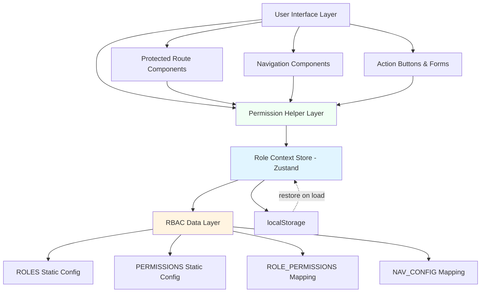
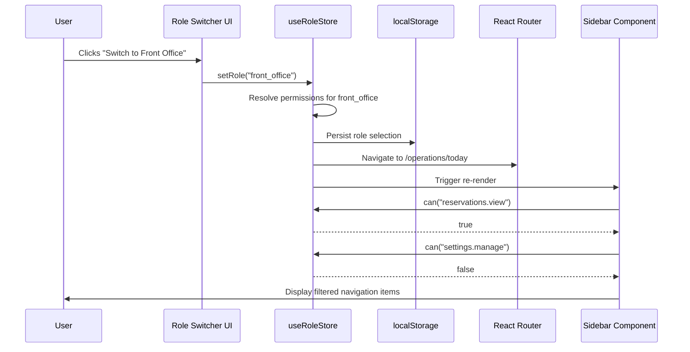

# Design Document: Role-Based Access Control (RBAC) System with Role Switcher

## Overview

This design document specifies the architecture and implementation strategy for a production-grade Role-Based Access Control (RBAC) system integrated into the Fortune Next v6.5 Hotel Management Training PMS. The system transforms the existing cosmetic role selector into a comprehensive access control engine that enforces permissions at multiple layers: navigation visibility, route protection, and action authorization.

### Design Goals

1. **Single Source of Truth**: Centralize role and permission definitions in static data structures
2. **Declarative Permission Checking**: Provide simple, reusable helper functions (can, canAny) for components
3. **Multi-Layer Enforcement**: Protect access at navigation rendering, routing, and action execution
4. **Demo Mode Experience**: Enable training users to switch roles and immediately see permission-restricted views
5. **Session Persistence**: Maintain role selection across page refreshes and navigation events
6. **Scalable Architecture**: Support future expansion to more roles and permissions without refactoring

### System Boundaries

**In Scope:**
- Four distinct roles: Hotel Manager, Front Office, Housekeeping, Waiter/F&B
- Granular permission system with 30+ permission keys
- Global role context state management (Zustand)
- Protected route components with automatic redirect
- Navigation menu filtering based on role permissions
- Demo Mode badge UI component
- Role switcher interface in Settings page

**Out of Scope:**
- Backend API authentication (demo/training environment only)
- Multi-user session management
- Permission inheritance hierarchies
- Dynamic role creation via admin UI
- Audit logging to persistent storage


## Architecture

### High-Level Architecture Diagram



### Architecture Layers

#### 1. Data Layer (Static Configurations)
- **ROLES**: Array of role objects with metadata (id, name, description, color, icon)
- **PERMISSIONS**: Array of permission objects with metadata (key, category, description)
- **ROLE_PERMISSIONS**: Map from role_id → permission_key[]
- **NAV_CONFIG**: Map from role_id → { navItems[], defaultDashboard }

#### 2. State Management Layer (Zustand Store)
- **useRoleStore**: Global state containing currentRole, permissions, demoMode
- **Actions**: setRole(), can(), canAny(), getRoleName()
- **Persistence**: Automatic sync to localStorage

#### 3. Permission Helper Layer
- **can(permissionKey)**: Boolean check for single permission
- **canAny(permissionKeys[])**: Boolean check for at least one permission
- **RequirePermission Component**: Conditional rendering wrapper

#### 4. UI Enforcement Layer
- **ProtectedRoute**: Route-level permission enforcement with redirect
- **Sidebar**: Dynamic navigation menu based on role permissions
- **TopHeader**: Demo Mode badge display
- **Settings Page**: Role switcher UI panel


### Data Flow



### Permission Resolution Algorithm

```
function resolvePermissions(roleId):
    if roleId == "hotel_manager":
        return ["*"]  // wildcard grants all permissions
    else:
        return ROLE_PERMISSIONS[roleId]  // explicit array

function can(permissionKey):
    currentPermissions = getRoleStore().permissions
    
    if currentPermissions includes "*":
        return true
    
    if currentPermissions includes permissionKey:
        return true
    
    // Future: support hierarchical checks (e.g., "reservations.*")
    return false
```


## Components and Interfaces

### 1. RBAC Data Structures

#### File: `src/config/rbac.js`

**ROLES Configuration:**
```javascript
export const ROLES = [
  {
    id: "hotel_manager",
    name: "Hotel Manager",
    description: "Full system access with administrative privileges",
    color: "red",
    icon: "ShieldCheck",
    capabilities: [
      "Manage all reservations and billing",
      "Access all reports and analytics",
      "Configure system settings",
      "Manage users and roles"
    ]
  },
  {
    id: "front_office",
    name: "Front Office Agent",
    description: "Handle guest services, reservations, and billing",
    color: "blue",
    icon: "Users",
    capabilities: [
      "Create and manage reservations",
      "Check in/out guests",
      "Process payments and billing",
      "View room status"
    ]
  },
  {
    id: "housekeeping",
    name: "Housekeeping Staff",
    description: "Manage room cleaning and maintenance",
    color: "green",
    icon: "Sparkles",
    capabilities: [
      "Update room status",
      "View assigned rooms",
      "Report maintenance issues",
      "Track cleaning schedules"
    ]
  },
  {
    id: "waiter_fnb",
    name: "Waiter / F&B Staff",
    description: "Manage restaurant orders and billing",
    color: "orange",
    icon: "Coffee",
    capabilities: [
      "Create F&B orders",
      "Manage table assignments",
      "Process F&B payments",
      "Print bills"
    ]
  }
];
```


**PERMISSIONS Configuration:**
```javascript
export const PERMISSIONS = {
  // Reservation Management
  RESERVATIONS_VIEW: "reservations.view",
  RESERVATIONS_CREATE: "reservations.create",
  RESERVATIONS_EDIT: "reservations.edit",
  RESERVATIONS_CANCEL: "reservations.cancel",
  
  // Guest Management
  GUESTS_VIEW: "guests.view",
  GUESTS_EDIT: "guests.edit",
  
  // Room Management
  ROOMS_VIEW: "rooms.view",
  ROOMS_CHANGE_STATUS: "rooms.change_status",
  ROOMS_CONFIGURE: "rooms.configure",
  
  // Check-in/Check-out
  CHECKIN_PERFORM: "checkin.perform",
  CHECKOUT_PERFORM: "checkout.perform",
  
  // Billing & Cashiering
  BILLING_POST_CHARGES: "billing.post_charges",
  BILLING_PROCESS_PAYMENTS: "billing.process_payments",
  BILLING_GENERATE_INVOICE: "billing.generate_invoice",
  
  // Housekeeping
  HOUSEKEEPING_VIEW: "housekeeping.view",
  HOUSEKEEPING_UPDATE_STATUS: "housekeeping.update_status",
  HOUSEKEEPING_REPORT_MAINTENANCE: "housekeeping.report_maintenance",
  
  // F&B Operations
  FNB_CREATE_ORDER: "fnb.create_order",
  FNB_MANAGE_TABLES: "fnb.manage_tables",
  FNB_SEND_TO_KITCHEN: "fnb.send_to_kitchen",
  FNB_PRINT_BILL: "fnb.print_bill",
  FNB_PROCESS_PAYMENT: "fnb.process_payment",
  
  // Reports & Analytics
  REPORTS_VIEW: "reports.view",
  ANALYTICS_VIEW: "analytics.view",
  
  // System Administration
  SETTINGS_MANAGE: "settings.manage",
  USERS_MANAGE: "users.manage",
  ROLES_MANAGE: "roles.manage",
  INVENTORY_MANAGE: "inventory.manage"
};
```


**ROLE_PERMISSIONS Mapping:**
```javascript
export const ROLE_PERMISSIONS = {
  hotel_manager: ["*"], // Wildcard grants all permissions
  
  front_office: [
    PERMISSIONS.RESERVATIONS_VIEW,
    PERMISSIONS.RESERVATIONS_CREATE,
    PERMISSIONS.RESERVATIONS_EDIT,
    PERMISSIONS.CHECKIN_PERFORM,
    PERMISSIONS.CHECKOUT_PERFORM,
    PERMISSIONS.ROOMS_VIEW,
    PERMISSIONS.ROOMS_CHANGE_STATUS,
    PERMISSIONS.GUESTS_VIEW,
    PERMISSIONS.GUESTS_EDIT,
    PERMISSIONS.BILLING_POST_CHARGES,
    PERMISSIONS.BILLING_PROCESS_PAYMENTS,
    PERMISSIONS.BILLING_GENERATE_INVOICE
  ],
  
  housekeeping: [
    PERMISSIONS.ROOMS_VIEW,
    PERMISSIONS.HOUSEKEEPING_VIEW,
    PERMISSIONS.HOUSEKEEPING_UPDATE_STATUS,
    PERMISSIONS.HOUSEKEEPING_REPORT_MAINTENANCE
  ],
  
  waiter_fnb: [
    PERMISSIONS.FNB_CREATE_ORDER,
    PERMISSIONS.FNB_MANAGE_TABLES,
    PERMISSIONS.FNB_SEND_TO_KITCHEN,
    PERMISSIONS.FNB_PRINT_BILL,
    PERMISSIONS.FNB_PROCESS_PAYMENT
  ]
};
```


**NAV_CONFIG Mapping:**
```javascript
export const NAV_CONFIG = {
  hotel_manager: {
    defaultDashboard: "/dashboard",
    navItems: [
      { path: "/dashboard", label: "Dashboard", icon: "LayoutDashboard" },
      { path: "/rooms", label: "Room Status", icon: "Grid" },
      { path: "/reservations", label: "Reservations", icon: "Calendar" },
      { path: "/checkin", label: "Check In", icon: "LogIn" },
      { path: "/checkout", label: "Check Out", icon: "LogOut" },
      { path: "/cashiering", label: "Cashiering", icon: "Wallet" },
      { path: "/housekeeping", label: "Housekeeping", icon: "Sparkles" },
      { path: "/reports", label: "Reports", icon: "BarChart3" },
      { path: "/settings", label: "Settings", icon: "Settings" }
    ]
  },
  
  front_office: {
    defaultDashboard: "/dashboard",
    navItems: [
      { path: "/dashboard", label: "Dashboard", icon: "LayoutDashboard" },
      { path: "/rooms", label: "Room Status", icon: "Grid" },
      { path: "/reservations", label: "Reservations", icon: "Calendar" },
      { path: "/checkin", label: "Check In", icon: "LogIn" },
      { path: "/checkout", label: "Check Out", icon: "LogOut" },
      { path: "/cashiering", label: "Cashiering", icon: "Wallet" },
      { path: "/settings", label: "Settings", icon: "Settings" }
    ]
  },
  
  housekeeping: {
    defaultDashboard: "/housekeeping",
    navItems: [
      { path: "/housekeeping", label: "Housekeeping", icon: "Sparkles" },
      { path: "/rooms", label: "Room Status", icon: "Grid" },
      { path: "/settings", label: "Settings", icon: "Settings" }
    ]
  },
  
  waiter_fnb: {
    defaultDashboard: "/fnb",
    navItems: [
      { path: "/fnb", label: "F&B Orders", icon: "Coffee" },
      { path: "/fnb/tables", label: "Tables", icon: "Grid" },
      { path: "/settings", label: "Settings", icon: "Settings" }
    ]
  }
};
```


### 2. Role Context Store (Zustand)

#### File: `src/store/useRoleStore.js`

```javascript
import { create } from "zustand";
import { ROLES, ROLE_PERMISSIONS, NAV_CONFIG } from "../config/rbac.js";

const STORAGE_KEY = "pms_demo_role";

export const useRoleStore = create((set, get) => ({
  // State
  currentRole: null,
  permissions: [],
  demoMode: true,
  
  // Initialize from localStorage or default to hotel_manager
  initialize: () => {
    const storedRole = localStorage.getItem(STORAGE_KEY);
    const roleId = storedRole || "hotel_manager";
    get().setRole(roleId);
  },
  
  // Set active role and resolve permissions
  setRole: (roleId) => {
    const role = ROLES.find(r => r.id === roleId);
    if (!role) {
      console.error(`Invalid role: ${roleId}`);
      return;
    }
    
    const permissions = ROLE_PERMISSIONS[roleId] || [];
    localStorage.setItem(STORAGE_KEY, roleId);
    
    set({
      currentRole: roleId,
      permissions: permissions,
      demoMode: true
    });
    
    console.log(`[RBAC] Role switched to: ${role.name}`);
    console.log(`[RBAC] Permissions:`, permissions);
  },
  
  // Get role metadata
  getRoleMetadata: () => {
    const roleId = get().currentRole;
    return ROLES.find(r => r.id === roleId);
  },
  
  // Get navigation config for current role
  getNavConfig: () => {
    const roleId = get().currentRole;
    return NAV_CONFIG[roleId] || NAV_CONFIG.hotel_manager;
  },
  
  // Permission check: single permission
  can: (permissionKey) => {
    const { permissions } = get();
    
    // Wildcard grants all permissions
    if (permissions.includes("*")) {
      return true;
    }
    
    // Check exact match
    return permissions.includes(permissionKey);
  },
  
  // Permission check: at least one permission
  canAny: (permissionKeys) => {
    return permissionKeys.some(key => get().can(key));
  },
  
  // Permission check: all permissions required
  canAll: (permissionKeys) => {
    return permissionKeys.every(key => get().can(key));
  }
}));

// Initialize store on module load
if (typeof window !== "undefined") {
  useRoleStore.getState().initialize();
}
```


### 3. Permission Helper Hook

#### File: `src/hooks/usePermissions.js`

```javascript
import { useRoleStore } from "../store/useRoleStore.js";

export const usePermissions = () => {
  const currentRole = useRoleStore((state) => state.currentRole);
  const permissions = useRoleStore((state) => state.permissions);
  const can = useRoleStore((state) => state.can);
  const canAny = useRoleStore((state) => state.canAny);
  const canAll = useRoleStore((state) => state.canAll);
  const getRoleMetadata = useRoleStore((state) => state.getRoleMetadata);
  
  const roleMetadata = getRoleMetadata();
  
  return {
    currentRole,
    permissions,
    can,
    canAny,
    canAll,
    roleName: roleMetadata?.name || "Unknown",
    roleDescription: roleMetadata?.description || "",
    isManager: currentRole === "hotel_manager"
  };
};

export default usePermissions;
```

### 4. RequirePermission Component

#### File: `src/components/auth/RequirePermission.jsx`

```javascript
import React from "react";
import { usePermissions } from "../../hooks/usePermissions.js";

export const RequirePermission = ({ permission, permissions, children, fallback = null }) => {
  const { can, canAny } = usePermissions();
  
  // Check single permission
  if (permission && !can(permission)) {
    return fallback;
  }
  
  // Check multiple permissions (at least one required)
  if (permissions && !canAny(permissions)) {
    return fallback;
  }
  
  return <>{children}</>;
};

export default RequirePermission;
```


### 5. ProtectedRoute Component

#### File: `src/components/auth/ProtectedRoute.jsx`

```javascript
import React, { useEffect } from "react";
import { Navigate, useLocation } from "react-router-dom";
import { usePermissions } from "../../hooks/usePermissions.js";
import { useRoleStore } from "../../store/useRoleStore.js";
import toast from "react-hot-toast";

export const ProtectedRoute = ({ children, requiredPermissions = [] }) => {
  const { canAll } = usePermissions();
  const location = useLocation();
  const getNavConfig = useRoleStore((state) => state.getNavConfig);
  
  // Check if user has all required permissions
  const hasPermission = requiredPermissions.length === 0 || canAll(requiredPermissions);
  
  useEffect(() => {
    if (!hasPermission) {
      console.warn(`[RBAC] Access denied to ${location.pathname}. Required permissions:`, requiredPermissions);
      toast.error("Access Denied: You do not have permission to view this page");
    }
  }, [hasPermission, location.pathname, requiredPermissions]);
  
  if (!hasPermission) {
    const navConfig = getNavConfig();
    return <Navigate to={navConfig.defaultDashboard} replace />;
  }
  
  return <>{children}</>;
};

export default ProtectedRoute;
```


### 6. Updated Sidebar Component

#### File: `src/components/layout/Sidebar.jsx` (Key Changes)

```javascript
import { useRoleStore } from "../../store/useRoleStore.js";
import * as LucideIcons from "lucide-react";

export const Sidebar = () => {
  const [isCollapsed, setIsCollapsed] = useState(false);
  const location = useLocation();
  const { logout } = useAuth();
  const getNavConfig = useRoleStore((state) => state.getNavConfig);
  
  // Get navigation items for current role
  const { navItems } = getNavConfig();

  return (
    <aside className={/* existing styles */}>
      {/* Brand header... */}
      
      <nav className="space-y-1 px-3">
        {navItems.map((item, index) => {
          const Icon = LucideIcons[item.icon] || LucideIcons.Circle;
          const isActive = location.pathname === item.path || 
                          (item.path !== "/" && location.pathname.startsWith(item.path));

          return (
            <Link key={index} to={item.path} className={/* existing styles */}>
              <Icon className="w-4 h-4 shrink-0" />
              {!isCollapsed && <span>{item.label}</span>}
            </Link>
          );
        })}
      </nav>
      
      {/* Logout footer... */}
    </aside>
  );
};
```


### 7. Demo Mode Badge Component

#### File: `src/components/layout/DemoModeBadge.jsx`

```javascript
import React from "react";
import { Link } from "react-router-dom";
import { Shield } from "lucide-react";
import { usePermissions } from "../../hooks/usePermissions.js";
import { useRoleStore } from "../../store/useRoleStore.js";

export const DemoModeBadge = () => {
  const { roleName } = usePermissions();
  const demoMode = useRoleStore((state) => state.demoMode);
  
  if (!demoMode) {
    return null;
  }
  
  return (
    <Link 
      to="/settings?tab=roles" 
      className="fixed top-16 right-4 z-50 bg-amber-500 text-white px-3 py-1.5 rounded-full shadow-lg hover:bg-amber-600 transition-all flex items-center space-x-2 text-xs font-bold"
    >
      <Shield className="w-4 h-4" />
      <span>Demo Mode — Viewing as: {roleName}</span>
    </Link>
  );
};

export default DemoModeBadge;
```

**Integration in AppLayout.jsx:**
```javascript
import DemoModeBadge from "../layout/DemoModeBadge.jsx";

export const AppLayout = () => {
  // existing code...
  
  return (
    <div className="h-screen flex flex-col">
      <TopHeader onMenuClick={() => setIsMobileMenuOpen(true)} />
      <DemoModeBadge />
      
      <div className="flex flex-1 overflow-hidden">
        <Sidebar />
        {/* main content... */}
      </div>
    </div>
  );
};
```


### 8. Role Switcher UI Component

#### File: `src/components/settings/RoleSwitcher.jsx`

```javascript
import React from "react";
import { useNavigate } from "react-router-dom";
import { ROLES } from "../../config/rbac.js";
import { useRoleStore } from "../../store/useRoleStore.js";
import { usePermissions } from "../../hooks/usePermissions.js";
import * as LucideIcons from "lucide-react";
import toast from "react-hot-toast";

export const RoleSwitcher = () => {
  const navigate = useNavigate();
  const { currentRole } = usePermissions();
  const setRole = useRoleStore((state) => state.setRole);
  const getNavConfig = useRoleStore((state) => state.getNavConfig);
  
  const handleSwitchRole = (roleId) => {
    setRole(roleId);
    const navConfig = getNavConfig();
    navigate(navConfig.defaultDashboard);
    
    const role = ROLES.find(r => r.id === roleId);
    toast.success(`Switched to: ${role.name}`);
  };
  
  return (
    <div className="space-y-4">
      <div className="border-b border-gray-100 pb-3">
        <h3 className="font-black text-slate-800 uppercase text-[10px]">
          Role Switcher (Demo Mode)
        </h3>
        <p className="text-[10px] text-gray-400 mt-1">
          Preview how the system looks and behaves for each staff role. 
          This is for demonstration only — no real user accounts are affected.
        </p>
      </div>
      
      <div className="grid grid-cols-1 sm:grid-cols-2 gap-4">
        {ROLES.map((role) => {
          const Icon = LucideIcons[role.icon] || LucideIcons.User;
          const isActive = currentRole === role.id;
          const borderColor = `border-${role.color}-500`;
          const bgColor = `bg-${role.color}-50/20`;
          
          return (
            <div
              key={role.id}
              className={`border border-l-4 ${borderColor} ${bgColor} rounded-lg p-4 cursor-pointer hover:shadow-md transition-all ${
                isActive ? "ring-2 ring-slate-800 shadow-lg" : ""
              }`}
              onClick={() => handleSwitchRole(role.id)}
            >
              <div className="flex items-center justify-between mb-3">
                <div className="flex items-center space-x-2">
                  <Icon className="w-5 h-5" />
                  <span className="font-bold text-sm">{role.name}</span>
                </div>
                {isActive && (
                  <span className="text-[9px] bg-slate-800 text-white font-bold px-2 py-1 rounded uppercase">
                    Currently Active
                  </span>
                )}
              </div>
              
              <p className="text-xs text-gray-600 mb-3">{role.description}</p>
              
              <div className="text-[10px] text-gray-500">
                <span className="font-bold">You'll be able to:</span>
                <ul className="mt-1.5 space-y-1 list-disc list-inside">
                  {role.capabilities.slice(0, 4).map((cap, idx) => (
                    <li key={idx}>{cap}</li>
                  ))}
                </ul>
              </div>
              
              {!isActive && (
                <button
                  onClick={(e) => {
                    e.stopPropagation();
                    handleSwitchRole(role.id);
                  }}
                  className="mt-4 w-full py-2 px-4 bg-slate-800 hover:bg-slate-900 text-white rounded font-bold text-xs transition-all"
                >
                  Switch to this role
                </button>
              )}
            </div>
          );
        })}
      </div>
    </div>
  );
};

export default RoleSwitcher;
```


### 9. Updated App.tsx with Route Protection

#### File: `src/App.tsx` (Key Changes)

```javascript
import ProtectedRoute from "./components/auth/ProtectedRoute.jsx";
import { PERMISSIONS } from "./config/rbac.js";

export default function App() {
  return (
    <BrowserRouter>
      <Toaster />
      
      <Routes>
        <Route path="/login" element={<PublicRoute><Login /></PublicRoute>} />
        
        <Route path="/" element={<ProtectedRoute><AppLayout /></ProtectedRoute>}>
          <Route index element={<Navigate to="/dashboard" replace />} />
          
          <Route path="dashboard" element={<Dashboard />} />
          
          <Route 
            path="rooms" 
            element={
              <ProtectedRoute requiredPermissions={[PERMISSIONS.ROOMS_VIEW]}>
                <RoomStatus />
              </ProtectedRoute>
            } 
          />
          
          <Route 
            path="reservations" 
            element={
              <ProtectedRoute requiredPermissions={[PERMISSIONS.RESERVATIONS_VIEW]}>
                <Reservations />
              </ProtectedRoute>
            } 
          />
          
          <Route 
            path="reservations/new" 
            element={
              <ProtectedRoute requiredPermissions={[PERMISSIONS.RESERVATIONS_CREATE]}>
                <NewReservation />
              </ProtectedRoute>
            } 
          />
          
          <Route 
            path="checkin" 
            element={
              <ProtectedRoute requiredPermissions={[PERMISSIONS.CHECKIN_PERFORM]}>
                <CheckIn />
              </ProtectedRoute>
            } 
          />
          
          <Route 
            path="checkout" 
            element={
              <ProtectedRoute requiredPermissions={[PERMISSIONS.CHECKOUT_PERFORM]}>
                <CheckOut />
              </ProtectedRoute>
            } 
          />
          
          <Route 
            path="cashiering" 
            element={
              <ProtectedRoute requiredPermissions={[PERMISSIONS.BILLING_POST_CHARGES]}>
                <Cashiering />
              </ProtectedRoute>
            } 
          />
          
          <Route 
            path="housekeeping" 
            element={
              <ProtectedRoute requiredPermissions={[PERMISSIONS.HOUSEKEEPING_VIEW]}>
                <HouseKeeping />
              </ProtectedRoute>
            } 
          />
          
          <Route 
            path="reports" 
            element={
              <ProtectedRoute requiredPermissions={[PERMISSIONS.REPORTS_VIEW]}>
                <Reports />
              </ProtectedRoute>
            } 
          />
          
          <Route path="settings" element={<Settings />} />
        </Route>
        
        <Route path="*" element={<NotFound />} />
      </Routes>
    </BrowserRouter>
  );
}
```


## Data Models

### Role Model

```typescript
interface Role {
  id: string;              // Unique identifier (e.g., "hotel_manager")
  name: string;            // Display name (e.g., "Hotel Manager")
  description: string;     // Brief description of role purpose
  color: string;           // UI color theme (e.g., "red", "blue")
  icon: string;            // Lucide icon name (e.g., "ShieldCheck")
  capabilities: string[];  // Human-readable list of top capabilities
}
```

### Permission Model

```typescript
interface Permission {
  key: string;        // Dot-notation permission key (e.g., "reservations.view")
  category: string;   // Category grouping (e.g., "Reservations")
  description: string; // Human-readable description
}
```

### RolePermissionsMap Model

```typescript
type RolePermissionsMap = {
  [roleId: string]: string[];  // roleId → permission keys[]
};

// Example:
// {
//   "hotel_manager": ["*"],
//   "front_office": ["reservations.view", "reservations.create", ...]
// }
```

### NavConfigMap Model

```typescript
interface NavItem {
  path: string;     // Route path (e.g., "/dashboard")
  label: string;    // Display label (e.g., "Dashboard")
  icon: string;     // Lucide icon name (e.g., "LayoutDashboard")
}

interface NavConfig {
  defaultDashboard: string;  // Default landing page for role
  navItems: NavItem[];       // Visible navigation items
}

type NavConfigMap = {
  [roleId: string]: NavConfig;
};
```


### RoleStore State Model

```typescript
interface RoleStoreState {
  // State
  currentRole: string | null;        // Active role ID
  permissions: string[];             // Resolved permission keys for current role
  demoMode: boolean;                 // Demo mode flag
  
  // Actions
  initialize: () => void;            // Initialize from localStorage
  setRole: (roleId: string) => void; // Switch active role
  getRoleMetadata: () => Role | undefined; // Get current role metadata
  getNavConfig: () => NavConfig;     // Get navigation config for current role
  
  // Permission Helpers
  can: (permissionKey: string) => boolean;           // Check single permission
  canAny: (permissionKeys: string[]) => boolean;     // Check at least one permission
  canAll: (permissionKeys: string[]) => boolean;     // Check all permissions
}
```

### LocalStorage Schema

```typescript
// Key: "pms_demo_role"
// Value: roleId (string)

// Example:
localStorage.setItem("pms_demo_role", "front_office");
```


## Security Architecture

### Multi-Layer Permission Enforcement

The RBAC system enforces permissions at four distinct layers:

#### Layer 1: UI Element Visibility
- **Component**: RequirePermission wrapper
- **Behavior**: Conditionally renders children based on permission check
- **Example**: Hide "Cancel Reservation" button if user lacks `reservations.cancel`
- **Enforcement**: Client-side only (for UX)

#### Layer 2: Navigation Menu Filtering
- **Component**: Sidebar
- **Behavior**: Displays only navItems from NAV_CONFIG for current role
- **Example**: Housekeeping role sees only "Housekeeping" and "Room Status" links
- **Enforcement**: Client-side only (for UX)

#### Layer 3: Route Protection
- **Component**: ProtectedRoute
- **Behavior**: Redirects to default dashboard if user lacks required permissions
- **Example**: Front Office user typing `/reports` gets redirected to `/dashboard`
- **Enforcement**: Client-side (router-level)

#### Layer 4: Action Authorization (Future)
- **Component**: API/Service layer
- **Behavior**: Verify permissions before executing state mutations
- **Example**: Check `billing.post_charges` before allowing payment posting
- **Enforcement**: Service layer (business logic)

### Security Considerations

**Client-Side Nature:**
- All current enforcement is client-side for demo/training purposes
- Real production systems require server-side permission verification
- Treat this as a UX layer, not a security boundary

**Audit Logging:**
- Console logging for unauthorized access attempts
- Educational purpose: helps students understand access control concepts

**Session Persistence:**
- Role selection stored in localStorage (not secure storage)
- Acceptable for training environment
- Production systems should use secure session tokens


### Permission Inheritance (Future Enhancement)

The current design uses flat permission lists. Future enhancements could support hierarchical permissions:

```javascript
// Example hierarchical permission check
function canHierarchical(permissionKey) {
  const permissions = getRoleStore().permissions;
  
  // Wildcard grants all
  if (permissions.includes("*")) return true;
  
  // Exact match
  if (permissions.includes(permissionKey)) return true;
  
  // Hierarchical check: "reservations.*" grants "reservations.view"
  const parts = permissionKey.split(".");
  for (let i = parts.length - 1; i > 0; i--) {
    const parentKey = parts.slice(0, i).join(".") + ".*";
    if (permissions.includes(parentKey)) return true;
  }
  
  return false;
}
```

This would allow more flexible permission definitions:
```javascript
// Instead of listing all individual permissions:
["reservations.view", "reservations.create", "reservations.edit", "reservations.cancel"]

// Could use wildcard:
["reservations.*"]
```


## Integration Strategy

### Phase 1: Core Infrastructure
1. Create `src/config/rbac.js` with ROLES, PERMISSIONS, ROLE_PERMISSIONS, NAV_CONFIG
2. Create `src/store/useRoleStore.js` with Zustand store
3. Create `src/hooks/usePermissions.js` helper hook
4. Create `src/components/auth/RequirePermission.jsx` wrapper
5. Create `src/components/auth/ProtectedRoute.jsx` wrapper

### Phase 2: UI Integration
6. Update `src/components/layout/Sidebar.jsx` to use NAV_CONFIG
7. Create `src/components/layout/DemoModeBadge.jsx`
8. Update `src/components/layout/AppLayout.jsx` to include badge
9. Create `src/components/settings/RoleSwitcher.jsx`
10. Update `src/pages/Settings.jsx` to include role switcher panel

### Phase 3: Route Protection
11. Update `src/App.tsx` to wrap routes with ProtectedRoute
12. Test all routes with different roles
13. Verify redirect behavior and toast notifications

### Phase 4: Component-Level Protection
14. Add RequirePermission wrappers to action buttons across pages
15. Update forms and modals to hide unauthorized actions
16. Test UI element visibility for all roles

### Testing Checklist

**Role Switching:**
- [ ] Switch to Hotel Manager → See all navigation items
- [ ] Switch to Front Office → See limited navigation items
- [ ] Switch to Housekeeping → See minimal navigation items
- [ ] Switch to Waiter/F&B → See F&B-specific navigation items

**Route Protection:**
- [ ] Front Office user typing `/reports` → Redirected to `/dashboard`
- [ ] Housekeeping user typing `/cashiering` → Redirected to `/housekeeping`
- [ ] Waiter user typing `/rooms` → Redirected to `/fnb`
- [ ] Hotel Manager can access all routes

**Session Persistence:**
- [ ] Select Front Office role, refresh browser → Still Front Office
- [ ] Navigate between pages → Role persists
- [ ] Close browser, reopen → Role restored from localStorage

**Demo Mode Badge:**
- [ ] Badge visible when non-manager role selected
- [ ] Badge shows correct role name
- [ ] Clicking badge navigates to Settings → Demo panel


## UI/UX Design

### Role Switcher Panel (Settings Page)

**Layout:**
```
┌─────────────────────────────────────────────────────────┐
│ Role Switcher (Demo Mode)                              │
│ Preview how the system looks and behaves for each      │
│ staff role. This is for demonstration only.            │
├─────────────────────────────────────────────────────────┤
│ ┌─────────────────┐  ┌─────────────────┐              │
│ │ [Icon] Hotel    │  │ [Icon] Front    │              │
│ │ Manager         │  │ Office Agent    │              │
│ │ ✓ Currently     │  │                 │              │
│ │   Active        │  │ Handle guest... │              │
│ │                 │  │                 │              │
│ │ Full system...  │  │ You'll be able: │              │
│ │ You'll be able: │  │ • Create res... │              │
│ │ • Manage all... │  │ • Check in...   │              │
│ │ • Access all... │  │ • Process pay...│              │
│ │ • Configure...  │  │ • View room...  │              │
│ │ • Manage users..│  │                 │              │
│ └─────────────────┘  │ [Switch to role]│              │
│                      └─────────────────┘              │
│ ┌─────────────────┐  ┌─────────────────┐              │
│ │ [Icon] House-   │  │ [Icon] Waiter/  │              │
│ │ keeping Staff   │  │ F&B Staff       │              │
│ │                 │  │                 │              │
│ │ Manage room...  │  │ Manage rest...  │              │
│ │                 │  │                 │              │
│ │ You'll be able: │  │ You'll be able: │              │
│ │ • Update room...│  │ • Create F&B... │              │
│ │ • View assigned │  │ • Manage tables │              │
│ │ • Report main...│  │ • Process pay...│              │
│ │ • Track clean...│  │ • Print bills   │              │
│ │                 │  │                 │              │
│ │ [Switch to role]│  │ [Switch to role]│              │
│ └─────────────────┘  └─────────────────┘              │
└─────────────────────────────────────────────────────────┘
```


### Demo Mode Badge

**Visual Design:**
- **Position**: Fixed top-right corner, below TopHeader (top-16 right-4)
- **Style**: Amber background (#f59e0b), white text, rounded-full, shadow-lg
- **Content**: "Demo Mode — Viewing as: [Role Name]"
- **Icon**: Shield icon from lucide-react
- **Interaction**: Clickable link to Settings → Demo panel

**Responsive Behavior:**
- Desktop: Always visible in top-right corner
- Mobile: May need to adjust position to avoid header overlap
- Z-index: 50 (above content, below modals)

### Navigation Sidebar (Role-Filtered)

**Hotel Manager View:**
- Dashboard, Room Status, Reservations, Check In, Check Out, Cashiering, Housekeeping, Reports, Settings

**Front Office View:**
- Dashboard, Room Status, Reservations, Check In, Check Out, Cashiering, Settings

**Housekeeping View:**
- Housekeeping, Room Status, Settings

**Waiter/F&B View:**
- F&B Orders, Tables, Settings

**Design Principles:**
- Removed items don't appear at all (not greyed out, not disabled)
- Active role indicator in Role Switcher panel
- Smooth transitions when switching roles (no page flash)


### Action Button Patterns

**Example: Reservation Actions**
```javascript
<RequirePermission permission={PERMISSIONS.RESERVATIONS_EDIT}>
  <button onClick={handleEdit}>
    <Edit className="w-4 h-4" />
    Edit Reservation
  </button>
</RequirePermission>

<RequirePermission permission={PERMISSIONS.RESERVATIONS_CANCEL}>
  <button onClick={handleCancel} className="bg-red-600">
    <X className="w-4 h-4" />
    Cancel Reservation
  </button>
</RequirePermission>
```

**Example: Multiple Permission Check**
```javascript
<RequirePermission 
  permissions={[
    PERMISSIONS.BILLING_POST_CHARGES, 
    PERMISSIONS.BILLING_PROCESS_PAYMENTS
  ]}
>
  <button onClick={handlePayment}>
    <CreditCard className="w-4 h-4" />
    Post Payment
  </button>
</RequirePermission>
```


## Correctness Properties

*A property is a characteristic or behavior that should hold true across all valid executions of a system-essentially, a formal statement about what the system should do. Properties serve as the bridge between human-readable specifications and machine-verifiable correctness guarantees.*

**Applicability Assessment:**

This feature is primarily configuration and UI rendering, which are not ideal candidates for extensive property-based testing. Most requirements involve:
- Static configuration validation (ROLES, PERMISSIONS data structures)
- UI component rendering (sidebar, badge, role switcher panel)
- Integration behavior (localStorage persistence, routing, toast notifications)

However, the **core permission checking logic** (can, canAny functions) and **permission format validation** are suitable for property-based testing, as they involve universal rules that should hold across all inputs.

### Property 1: Permission Key Format Validation

*For any* permission key defined in the PERMISSIONS object, the key SHALL match the dot-notation format `category.action` where both category and action are lowercase alphanumeric with underscores.

**Validates: Requirements 1.5**

### Property 2: Hotel Manager Wildcard Access

*For any* permission key, when the current role is hotel_manager, the can(permissionKey) function SHALL return true.

**Validates: Requirements 3.2, 6.2**


### Property 3: Permission Check Consistency

*For any* role and any permission key, the can(permissionKey) function SHALL return true if and only if the role's permission array includes either the wildcard "*" or the exact permission key.

**Validates: Requirements 3.1**

### Property 4: canAny Disjunction Correctness

*For any* role and any array of permission keys, the canAny(permissionKeys) function SHALL return true if and only if at least one key in the array satisfies can(key).

**Validates: Requirements 3.3**

### Property 5: Navigation Config Completeness

*For any* role in the ROLES array, there SHALL exist a corresponding entry in NAV_CONFIG with both a defaultDashboard path and a navItems array.

**Validates: Requirements 1.4, 5.1**

### Property 6: Sidebar Navigation Filtering

*For any* role, the rendered sidebar navigation items SHALL be exactly the set of navItems defined in NAV_CONFIG[role], with no additional or missing items.

**Validates: Requirements 5.1, 5.2**


## Error Handling

### Permission Denied Scenarios

**Route Access Denied:**
- **Trigger**: User navigates to ProtectedRoute without required permissions
- **Behavior**: Redirect to role's default dashboard + toast notification
- **User Message**: "Access Denied: You do not have permission to view this page"
- **Logging**: Console warning with attempted path and required permissions

**Invalid Role Selection:**
- **Trigger**: setRole() called with non-existent roleId
- **Behavior**: Log error, maintain current role (no change)
- **User Message**: None (internal error)
- **Logging**: Console error with invalid roleId

**Missing Navigation Config:**
- **Trigger**: getNavConfig() called but NAV_CONFIG[roleId] undefined
- **Behavior**: Fallback to hotel_manager nav config
- **User Message**: None
- **Logging**: Console warning about missing config

**Permission Check on Invalid Key:**
- **Trigger**: can() called with empty string or null
- **Behavior**: Return false
- **User Message**: None
- **Logging**: Optional console warning for debugging

### Graceful Degradation

**localStorage Unavailable:**
- **Scenario**: localStorage blocked by browser settings or private mode
- **Fallback**: Default to hotel_manager role, store state in memory only
- **Impact**: Role selection won't persist across page refreshes

**Missing Permission in ROLE_PERMISSIONS:**
- **Scenario**: Permission key exists in PERMISSIONS but not assigned to any role
- **Fallback**: Permission check returns false (denied)
- **Impact**: No user can access that permission (expected behavior)

**Route Without Protection:**
- **Scenario**: Developer adds new route but forgets ProtectedRoute wrapper
- **Fallback**: Route accessible to all roles (open access)
- **Impact**: Security gap - should be caught in code review


## Testing Strategy

### Dual Testing Approach

The testing strategy combines **example-based unit tests** for configuration and UI, with **property-based tests** for core permission logic.

#### Unit Tests (Example-Based)

**Configuration Validation:**
- Verify ROLES array contains exactly 4 roles with expected IDs
- Verify PERMISSIONS object contains all required keys
- Verify ROLE_PERMISSIONS maps each role to correct permission array
- Verify hotel_manager has wildcard "*" permission
- Verify NAV_CONFIG maps each role to navItems and defaultDashboard

**Component Behavior:**
- RequirePermission renders children when permission granted
- RequirePermission renders null when permission denied
- ProtectedRoute allows access when permissions met
- ProtectedRoute redirects when permissions lacking
- Sidebar displays only role-specific navigation items
- DemoModeBadge shows correct role name
- RoleSwitcher highlights active role

**Integration Tests:**
- Role switching updates sidebar navigation
- Role switching navigates to correct default dashboard
- Role persistence to/from localStorage
- Unauthorized route access triggers toast notification
- Permission checks occur before route rendering


#### Property-Based Tests

**Test Library:** fast-check (for JavaScript/TypeScript)

**Property 1: Permission Key Format Validation**
- **Generator**: All keys from PERMISSIONS object
- **Property**: Each key matches regex `/^[a-z_]+\.[a-z_]+$/`
- **Iterations**: 100
- **Tag**: `Feature: role-switcher-rbac-engine, Property 1: For any permission key defined in PERMISSIONS, the key SHALL match dot-notation format`

**Property 2: Hotel Manager Wildcard Access**
- **Generator**: Arbitrary permission key strings
- **Setup**: Set role to hotel_manager
- **Property**: can(permissionKey) returns true for any key
- **Iterations**: 100
- **Tag**: `Feature: role-switcher-rbac-engine, Property 2: For any permission key, when role is hotel_manager, can() SHALL return true`

**Property 3: Permission Check Consistency**
- **Generator**: Arbitrary role from ROLES, arbitrary permission key
- **Property**: can(key) returns true ⟺ permissions includes "*" OR permissions includes key
- **Iterations**: 100
- **Tag**: `Feature: role-switcher-rbac-engine, Property 3: For any role and permission key, can() SHALL return true iff wildcard or exact match`

**Property 4: canAny Disjunction Correctness**
- **Generator**: Arbitrary role, arbitrary array of permission keys
- **Property**: canAny(keys) returns true ⟺ exists k in keys where can(k) is true
- **Iterations**: 100
- **Tag**: `Feature: role-switcher-rbac-engine, Property 4: For any role and permission array, canAny() SHALL return true iff at least one permission held`

**Property 5: Navigation Config Completeness**
- **Generator**: All roles from ROLES array
- **Property**: NAV_CONFIG[role.id] exists AND has defaultDashboard AND has navItems array
- **Iterations**: 100 (will test all 4 roles many times)
- **Tag**: `Feature: role-switcher-rbac-engine, Property 5: For any role, NAV_CONFIG SHALL have defaultDashboard and navItems`

**Property 6: Sidebar Navigation Filtering**
- **Generator**: All roles from ROLES array
- **Setup**: Render Sidebar component with role
- **Property**: Rendered navItems exactly match NAV_CONFIG[role.id].navItems
- **Iterations**: 100
- **Tag**: `Feature: role-switcher-rbac-engine, Property 6: For any role, sidebar navigation SHALL exactly match NAV_CONFIG`

### Test Coverage Goals

- **Configuration**: 100% coverage of RBAC data structures
- **Permission Logic**: 100% coverage of can/canAny/canAll functions
- **Component Rendering**: 90%+ coverage of conditional rendering logic
- **Integration Flows**: Key user journeys covered (role switching, route protection)

### Manual Testing Checklist

- [ ] Switch between all 4 roles and verify navigation changes
- [ ] Test direct URL navigation to restricted routes
- [ ] Verify Demo Mode badge appears for all roles
- [ ] Test browser refresh with each role selected
- [ ] Verify action buttons hide/show correctly per role
- [ ] Test localStorage persistence across browser sessions
- [ ] Verify console logging for unauthorized access attempts


## Implementation Notes

### Performance Considerations

**Zustand Store Selectors:**
- Use selective subscriptions to prevent unnecessary re-renders
- Example: `const can = useRoleStore(state => state.can)` only re-renders when can function changes

**Permission Check Caching:**
- Consider memoizing permission checks if performance issues arise
- Most checks are lightweight (array includes), so caching may not be necessary

**Navigation Menu Rendering:**
- NAV_CONFIG lookups are O(1) (object key access)
- Icon component dynamic imports handled by bundler

### Browser Compatibility

**localStorage API:**
- Supported in all modern browsers
- Fallback to memory-only storage if unavailable
- Private/incognito mode may block localStorage

**React Router:**
- Using react-router-dom v6+ declarative routing
- Navigate component for programmatic redirects

### Debugging Tools

**Console Logging:**
- Role changes logged with `[RBAC]` prefix
- Permission denials logged with required permissions
- Unauthorized access attempts logged with attempted path

**React DevTools:**
- Inspect useRoleStore state in Components panel
- View permission checks in real-time


### Future Enhancements

**1. Hierarchical Permissions:**
- Support wildcard patterns like `reservations.*` to grant all reservation permissions
- Implement parent-child permission relationships

**2. Dynamic Role Creation:**
- Admin UI to create/edit roles without code changes
- Store custom roles in database or localStorage

**3. Permission Groups:**
- Group related permissions (e.g., "Front Office Bundle")
- Assign permission groups to roles for easier management

**4. Audit Logging:**
- Track all permission denials with timestamp and user
- Export audit logs for training review

**5. Role Scheduling:**
- Auto-switch roles based on time of day (e.g., morning shift → housekeeping)
- Useful for simulating shift-based workflows

**6. Multi-Language Support:**
- Translate role names, descriptions, and UI text
- Support for regional training programs

**7. Backend Integration:**
- Connect to real authentication API
- Server-side permission verification
- Session management with JWT tokens

**8. Advanced Testing:**
- Visual regression testing for UI states
- E2E tests with Playwright or Cypress
- Accessibility testing (WCAG compliance)


## Appendix: Code Examples

### Example 1: Using RequirePermission in Component

```javascript
import { RequirePermission } from "../components/auth/RequirePermission.jsx";
import { PERMISSIONS } from "../config/rbac.js";

export const ReservationCard = ({ reservation }) => {
  return (
    <div className="reservation-card">
      <h3>{reservation.guest_name}</h3>
      <p>Room: {reservation.room_type}</p>
      
      <div className="actions">
        <RequirePermission permission={PERMISSIONS.RESERVATIONS_EDIT}>
          <button onClick={() => handleEdit(reservation)}>
            Edit Reservation
          </button>
        </RequirePermission>
        
        <RequirePermission permission={PERMISSIONS.RESERVATIONS_CANCEL}>
          <button onClick={() => handleCancel(reservation)} className="danger">
            Cancel Reservation
          </button>
        </RequirePermission>
        
        <RequirePermission permission={PERMISSIONS.CHECKIN_PERFORM}>
          <button onClick={() => handleCheckIn(reservation)}>
            Check In Guest
          </button>
        </RequirePermission>
      </div>
    </div>
  );
};
```


### Example 2: Programmatic Permission Check

```javascript
import { usePermissions } from "../hooks/usePermissions.js";
import { PERMISSIONS } from "../config/rbac.js";

export const ReservationActions = ({ reservation }) => {
  const { can, canAny } = usePermissions();
  
  const handleAction = (actionType) => {
    switch (actionType) {
      case "edit":
        if (!can(PERMISSIONS.RESERVATIONS_EDIT)) {
          toast.error("You don't have permission to edit reservations");
          return;
        }
        // Proceed with edit...
        break;
        
      case "billing":
        if (!canAny([PERMISSIONS.BILLING_POST_CHARGES, PERMISSIONS.BILLING_PROCESS_PAYMENTS])) {
          toast.error("You don't have billing permissions");
          return;
        }
        // Proceed with billing...
        break;
    }
  };
  
  return (
    <div className="actions">
      <button onClick={() => handleAction("edit")}>
        Edit
      </button>
      <button onClick={() => handleAction("billing")}>
        Post Charge
      </button>
    </div>
  );
};
```


### Example 3: Protected Route Usage

```javascript
import { ProtectedRoute } from "./components/auth/ProtectedRoute.jsx";
import { PERMISSIONS } from "./config/rbac.js";

<Routes>
  {/* Public route */}
  <Route path="/login" element={<Login />} />
  
  {/* Protected routes */}
  <Route path="/" element={<AppLayout />}>
    {/* No permission required - accessible to all roles */}
    <Route path="dashboard" element={<Dashboard />} />
    
    {/* Single permission required */}
    <Route 
      path="reservations" 
      element={
        <ProtectedRoute requiredPermissions={[PERMISSIONS.RESERVATIONS_VIEW]}>
          <Reservations />
        </ProtectedRoute>
      } 
    />
    
    {/* Multiple permissions required (user must have ALL) */}
    <Route 
      path="cashiering" 
      element={
        <ProtectedRoute 
          requiredPermissions={[
            PERMISSIONS.BILLING_POST_CHARGES,
            PERMISSIONS.BILLING_PROCESS_PAYMENTS
          ]}
        >
          <Cashiering />
        </ProtectedRoute>
      } 
    />
  </Route>
</Routes>
```


### Example 4: Property-Based Test (fast-check)

```javascript
import fc from "fast-check";
import { useRoleStore } from "../store/useRoleStore.js";
import { PERMISSIONS, ROLES } from "../config/rbac.js";

describe("Property-Based Tests: RBAC Permission Logic", () => {
  
  test("Property 2: Hotel Manager has wildcard access", () => {
    fc.assert(
      fc.property(
        fc.string({ minLength: 1 }), // arbitrary permission key
        (permissionKey) => {
          // Setup: switch to hotel_manager role
          useRoleStore.getState().setRole("hotel_manager");
          
          // Property: can() should return true for ANY key
          const result = useRoleStore.getState().can(permissionKey);
          
          expect(result).toBe(true);
        }
      ),
      { numRuns: 100 }
    );
  });
  
  test("Property 3: Permission check consistency", () => {
    fc.assert(
      fc.property(
        fc.constantFrom(...ROLES.map(r => r.id)), // arbitrary role
        fc.constantFrom(...Object.values(PERMISSIONS)), // arbitrary permission
        (roleId, permissionKey) => {
          // Setup: switch to role
          useRoleStore.getState().setRole(roleId);
          const permissions = useRoleStore.getState().permissions;
          
          // Property: can() should match (has wildcard OR has exact key)
          const result = useRoleStore.getState().can(permissionKey);
          const expected = permissions.includes("*") || permissions.includes(permissionKey);
          
          expect(result).toBe(expected);
        }
      ),
      { numRuns: 100 }
    );
  });
  
});
```

---

**End of Design Document**

